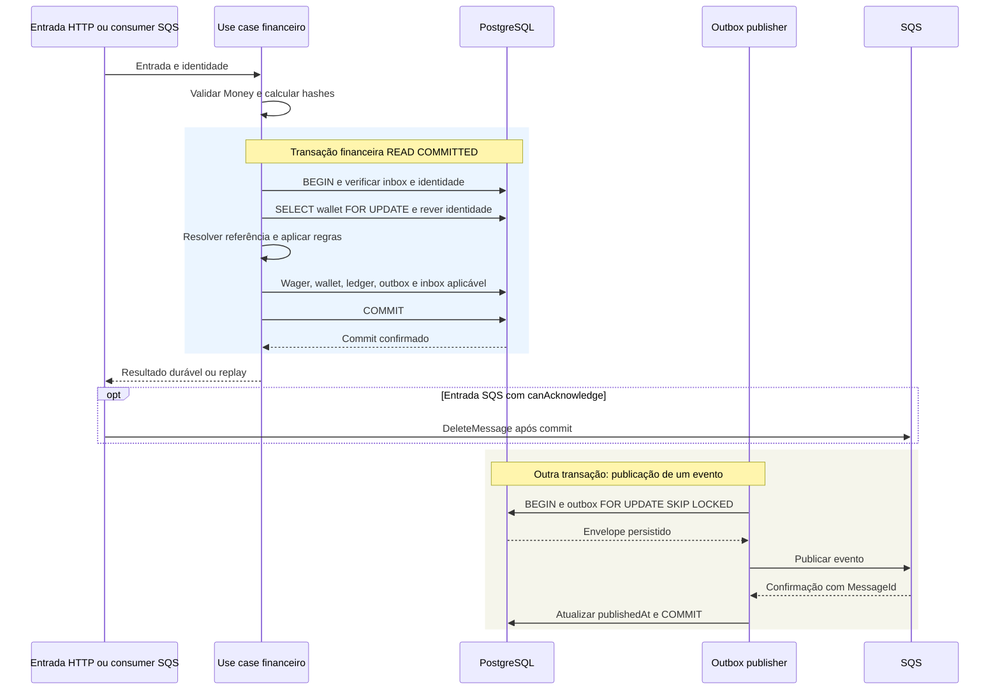

# Arquitetura e decisões técnicas

## Visão arquitetural

A solução é um monólito modular distribuído: três processos independentes da mesma aplicação compartilham PostgreSQL e SQS. Cada processo pode atender HTTP, consumir mensagens, publicar eventos e reprocessar referências. O Compose habilita os quatro componentes; fora dele, os workers dependem de flags explícitas.

A escolha mantém saldo, ledger e eventos em uma transação SQL local, sem coordenação distribuída entre microserviços. Reduz complexidade no timebox do desafio, ao custo de deploy e escala acoplados por processo. Flags permitem separar papéis de execução, preservando a mesma base.

| Camada | Responsabilidade | Exemplos |
| --- | --- | --- |
| `domain` | Entidades, Value Objects, invariantes e contratos de repositórios, sem NestJS, ORM ou AWS | Money, Wallet, WagerTransaction, WalletLedgerEntry |
| `application` | Orquestração financeira, transação por porta, hash, retry e contratos de leitura | ProcessWagerTransactionUseCase, OpenWalletUseCase, FinancialTransaction |
| `infrastructure` | Adaptadores PostgreSQL, HTTP/SQS, lifecycle, configuração e observabilidade | EntitySchemas, controllers, consumer, publisher e workers |

AppModule e módulos NestJS compõem dependências por factories/providers. HTTP e SQS chamam o mesmo `ProcessWagerTransactionUseCase`; `ReprocessPendingReferenceUseCase` delega ao reprocessamento desse núcleo. As regras financeiras não dependem do transporte.

## Decisões tecnológicas

| Tecnologia | Justificativa e consequência |
| --- | --- |
| Bun 1.x | Runtime, package manager e test runner exigidos pelo desafio; imagem com Bun 1.4.4. |
| TypeScript strict | Contratos explícitos, strictPropertyInitialization e ESM com imports relativos `.js`. |
| NestJS | Composição, controllers, validação e lifecycle; domínio/casos de uso sem decorators. |
| TypeORM | Familiaridade e timebox; aceito pelo desafio, que prefere MikroORM. EntityManager explícito controla a transação. |
| PostgreSQL 16.11 | Transações, locks de linha, constraints, índices parciais e triggers para arbitrar processos concorrentes. |
| LocalStack 4.14.0 | SQS em containers para desenvolvimento/testes, com versão fixada e credenciais fictícias, sem conta AWS real. |

O build usa `tsc`, experimentalDecorators e emitDecoratorMetadata; Bun executa o JavaScript compilado. Testes diretos pelo transpiler Bun não comprovam emissão de metadados. Testes do compilado verificam metadados e composição real do AppModule; DTOs declaram expectedType nos pipes para validação consistente nos dois modos.

EntitySchemas e mappers ficam separados do domínio, explicitando colunas sem depender dos metadados dos testes diretos. NUMERIC permanece string no driver/mappers, sem parser pg para `number`. Migrations são explícitas, versionadas e reversíveis; synchronize e migrationsRun ficam desabilitados. SQL gerado exige revisão: EntitySchemas não reproduzem todas as constraints/triggers manuais.

A imagem usa instalação frozen e estágios de build/dependências de produção. O runtime executa Bun como usuário `bun`, sem compilador TypeScript. O CLI TypeORM permanece disponível para migrations compiladas.

## Modelo financeiro

### Money e encapsulamento

[Money](src/domain/value-objects/money.ts) é um Value Object imutável: Decimal privado, instância congelada e operações que retornam novos valores. O clone de decimal.js isola configuração global, com 32 dígitos significativos e ROUND_HALF_EVEN. Adição/subtração de operandos limitados exige até 31 dígitos, preservando centavos antes de detectar overflow.

O intervalo corresponde a NUMERIC(30,2): 28 dígitos inteiros e duas casas, até `9999999999999999999999999999.99` em módulo. Contratos exigem strings com exatamente duas casas. Número JSON, expoentes, espaços, separadores, sinal positivo, zeros à esquerda e escala excedente são recusados, sem arredondamento de entrada.

`from` rejeita negativos, inclusive -0.00; `rehydrate` admite representação assinada. Subtração/negação podem produzir negativos internos; zero é serializado como 0.00. MoneyProps contém amount/currency, sem conversão monetária para ponto flutuante. BRL/USD são o subconjunto ISO-4217 aceito, sem normalização; operações binárias, inclusive comparações, rejeitam moedas distintas.

Entidades usam construtores restritos e factories. `rehydrate` reconstrói estado sem reaplicar movimentos/transições. Identidade imutável é readonly/congelada; estado mutável usa campos privados nativos e datas têm cópias defensivas. Mappers explícitos definem serialização, sem depender de enumeração de propriedades.

### Wallet, wager e ledger

Wallet é o Aggregate Root do saldo. `debit`/`credit` validam o lançamento antes de alterar saldo, versão e updatedAt. Somente movimento de valor estritamente positivo incrementa versão; abertura inicia sempre em 1. O aggregate não carrega coleção de lançamentos.

Saldo inicial zero insere somente wallet. Saldo positivo cria OPENING interno PROCESSED, crédito no ledger e eventos atomicamente. Provider `internal`, prefixo `opening:` e OPENING externo são reservados/rejeitados. Nova abertura para player/moeda existente é conflito, sem idempotência de criação no contrato.

WalletLedgerEntry valida direção, quantia positiva, saldos não negativos e equação financeira. Cada movimento corresponde a um lançamento imutável; LOSS e rejeições não geram ledger. O modelo é um ledger por wallet, sem partidas dobradas.

| Operação | Efeito | Referência e interpretação adotada |
| --- | --- | --- |
| BET | Débito positivo | Sem referência; saldo insuficiente gera INSUFFICIENT_FUNDS. |
| WIN | Crédito positivo | BET PROCESSED opcional; prêmio pode diferir da aposta. |
| LOSS | Nenhum | Valor não negativo; sem alteração de saldo/versão/ledger; referência externa não aceita na entrada. |
| REFUND | Crédito integral | BET PROCESSED; um REFUND processado por referência. |
| ROLLBACK | Inverso integral | BET, WIN ou REFUND PROCESSED; credita BET, debita WIN/REFUND; um ROLLBACK processado por referência. |

Referência é resolvida por provider/external ID e exige mesmo provider, player, wallet, moeda e rodada. gameId não integra essa igualdade porque a seção 7 do desafio não o exige, mas participa do hash. Autorreferência é INVALID_REFERENCE. Reversões parciais são recusadas; REFUND/ROLLBACK têm unicidade separada por tipo, sem proibição global entre tipos.

Reversão que debitaria além do saldo é rejeitada com INSUFFICIENT_REVERSAL_FUNDS, distinta de BET sem saldo. Referência PENDING/PENDING_REFERENCE tem contexto/tipo/valor validados antes de continuar aguardando; REJECTED/FAILED não é referência válida.

WagerTransaction nasce PENDING. Transições: PENDING → PENDING_REFERENCE/PROCESSED/REJECTED/FAILED; PENDING_REFERENCE → PENDING_REFERENCE/PROCESSED/REJECTED/FAILED. PROCESSED, REJECTED e FAILED são terminais; mutação posterior lança InvalidTransactionStateError. Processamento registra processedAt; rejeição/falha guarda failureCode.

Códigos financeiros incluem INSUFFICIENT_FUNDS, INSUFFICIENT_REVERSAL_FUNDS, CURRENCY_MISMATCH, INVALID_AMOUNT, INVALID_REFERENCE, INVALID_REFERENCE_KIND, REFERENCE_CONTEXT_MISMATCH, REFERENCE_AMOUNT_MISMATCH e REFERENCE_NOT_FOUND. A lista completa está em [financial.types.ts](src/domain/financial.types.ts). Overflow do saldo é rejeitado como INVALID_AMOUNT.

## Persistência e concorrência

### Schema e transações

| Tabela | Responsabilidade e proteção principal |
| --- | --- |
| `wallets` | Identidade player/moeda, saldo materializado, versão e datas; unicidade e saldo não negativo. |
| `wager_transactions` | Identidade/hash, contexto, referência, estado, snapshot original e agendamento persistente. |
| `wallet_ledger_entries` | Movimentos auditáveis e vínculo único por wallet/transação. |
| `inbox_messages` | Deduplicação por consumerName/messageId, hash e confirmação de processamento. |
| `outbox_messages` | Envelope JSONB, agregado, tipo, tentativas, próximo envio e publishedAt. |

[FinancialFoundation](src/infrastructure/database/migrations/1797000000000-financial-foundation.ts) cria as cinco tabelas. UNIQUE(player_id,currency) impede wallet duplicada; FK composta `(wallet_id,player_id,currency)` impede contexto divergente. Checks protegem moeda, valor, status, referências, não-negatividade, NaN e versão mínima.

Constraints distintas protegem chave global e provider/external ID. O índice parcial `uq_wager_processed_reversal` protege referência/tipo somente em REFUND/ROLLBACK PROCESSED, preservando tentativas rejeitadas. Trigger valida estado/contexto/tipo/valor integral da referência.

Ledger tem FKs sem cascade delete, UNIQUE(wallet_id,transaction_id), checks de direção/quantia/aritmética e trigger que exige wager PROCESSED e contexto correto, excluindo LOSS. Triggers rejeitam UPDATE/DELETE/TRUNCATE; o repositório não oferece alteração/exclusão. `guard_wager` protege identidade e mutação/exclusão de transações terminais.

Índices por wallet/data/ID, agendamento de referências e outbox não publicada suportam consultas/workers. Usuários administrativos podem desabilitar triggers ou alterar schema: produção exige papel restrito da aplicação e outro para migrations. PostgreSQL pode arredondar escala excedente antes dos checks de NUMERIC(30,2); Money rejeita essa entrada, e SQL direto exige validação equivalente na fronteira de escrita.

[TypeOrmFinancialTransaction](src/infrastructure/database/repositories/typeorm-financial-transaction.ts) usa READ COMMITTED e o mesmo EntityManager transacional nos cinco repositórios. Escritas/locks exigem QueryRunner ativo; SELECT FOR UPDATE bloqueia apenas a wallet envolvida antes do movimento. Sem lock global, wallets distintas avançam em paralelo. Versão é snapshot/auditoria, não o mecanismo de exclusão.

READ COMMITTED exige nova verificação de identidade depois de esperar o lock. Erros recuperáveis saem do callback para rollback completo; não se reutiliza transação abortada. Uma futura operação entre múltiplas wallets precisaria de ordem estável de locks; esse fluxo não está implementado.

### Retry e migrations

[withFinancialRetry](src/application/services/financial-retry.ts) limita a três tentativas totais, com nova transação/entidade por tentativa e identidade/hash preservados. Falhas classificadas como transitórias incluem deadlock, serialização, lock indisponível, cancelamento SQL/timeout e indisponibilidade/conexão. Esperas são 25ms e 50ms, sem jitter.

Unicidade recuperável de idempotência, identidade externa, reversão e inbox permite releitura imediata após rollback; a nova avaliação determina replay, conflito ou rejeição. Unicidade de wallet vira WALLET_CONFLICT; falhas permanentes não são repetidas. Esgotamento recuperável retorna TRANSIENT_FAILURE.

Infraestrutura/erro inesperado causa rollback, sem inventar rejeição financeira ou linha FAILED que não pôde ser confirmada atomicamente. FAILED já persistido é consultável/reproduzível.

[RejectedSnapshots](src/infrastructure/database/migrations/1797000001000-rejected-snapshots.ts) permite snapshot de saldo/versão em REJECTED/FAILED, além de PROCESSED. Novas rejeições preservam saldo observado; registros legados sem snapshot continuam sem esse dado, sem inventar saldo histórico.

O downgrade remove snapshots adicionais de REJECTED/FAILED, desabilitando/reabilitando guard_wager na mesma transação administrativa. Status, saldo e ledger permanecem, mas snapshots são perdidos. Reverter a fundação remove tabelas/dados. Testes reais verificam run/revert/run em bancos exclusivos; revert não é limpeza do banco principal.

## Idempotência e identidade

### Operação financeira

A chave de idempotência é global, compartilhada entre HTTP/SQS. O padrão recomendado inclui provider/external ID, sem geração automática. A identidade externa `(providerId,externalTransactionId)` tem constraint própria e não pode representar outra operação com chave diferente.

[canonicalPayloadHash](src/application/services/canonical-payload-hash.ts) calcula SHA-256 do JSON de providerId, externalTransactionId, walletId, playerId, roundId, gameId, kind, money e referência externa presente. Chaves são ordenadas recursivamente por unidades UTF-16; arrays preservam ordem, undefined opcional é omitido e Money usa representação normalizada.

Chave, IDs internos, datas, correlação, causalidade e transporte ficam fora do hash financeiro. Mesma chave/hash retorna resultado persistido; chave igual/hash divergente gera IDEMPOTENCY_CONFLICT. Identidade externa existente com outra chave gera EXTERNAL_IDENTITY_CONFLICT, mesmo com conteúdo financeiro igual.

Replay terminal usa saldo/versão originais, não saldo atual; não altera wallet, ledger ou eventos. Replay pendente devolve o estado observado sem aplicar novamente. Depois da resolução pelo worker, nova consulta/replay observa o estado terminal vigente, sem perpetuar a resposta 202 inicial.

As buscas por chave e identidade externa podem observar snapshots diferentes em READ COMMITTED. A segunda busca também compara chave/hash, evitando falso conflito se o vencedor confirmou entre leituras. Há nova verificação após lock e nova avaliação depois de rollback por unicidade.

### Inbox e transporte

Inbox usa `consumerName=wager-financial-v1` e messageId do envelope de negócio, compartilhados entre instâncias. [inboxPayloadHash](src/application/services/inbox-payload-hash.ts) calcula SHA-256 do JSON canônico `{payloadHash,idempotencyKey}`: inclui a chave além do digest financeiro, excluindo metadados de entrega.

checkInbox sempre compara hash; recordInbox usa o receipt validado pela consulta final. Se outra transação confirmou inbox divergente durante o processamento, INBOX_CONFLICT provoca rollback de todas as escritas. Se a leitura ainda viu ausência, a PK arbitra a inserção e outra tentativa reavalia após rollback. markProcessed preserva a primeira data com COALESCE.

Operação já processada por HTTP pode ganhar nova inbox sem novo débito/evento. Mesmo messageId/hash é redelivery; outra mensagem pode representar replay da mesma identidade financeira. Inbox e idempotência financeira são garantias distintas.

| Identificador | Significado |
| --- | --- |
| messageId do envelope | Identidade persistente da mensagem de negócio na inbox. |
| SQS MessageId | Identidade do envio no broker e diagnóstico de redelivery. |
| ReceiptHandle | Entrega atual, usada em DeleteMessage/ChangeMessageVisibility. |
| MessageDeduplicationId | Deduplicação FIFO com janela limitada; não substitui constraints financeiras. |

instanceId/processId são diagnósticos, sem integrar identidades financeiras/inbox. Correlação e causalidade permanecem nos eventos confirmados sem modificar hashes por transporte.

## Fluxo transacional

A ordem de uma operação nova é:

1. Validar entrada/Money e calcular hashes financeiro/inbox antes de abrir a transação.
2. Iniciar READ COMMITTED, criar entidade de tentativa e verificar inbox e identidade financeira.
3. Resolver replay/conflito existente ou bloquear a wallet por SELECT FOR UPDATE.
4. Verificar identidade novamente após lock; conferir player/moeda e resolver referência/reversão anterior.
5. Aplicar regras de domínio, mantendo pendência ou rejeição financeira quando necessário.
6. Persistir wager com estado/snapshot final, wallet alterada, ledger existente, outbox e inbox aplicável.
7. Confirmar commit; somente então devolver resultado HTTP ou autorização de ACK ao consumer.
8. Publicar outbox em outra transação, independente da financeira original.

A wager precisa estar PROCESSED antes de inserir ledger, conforme a trigger. Não há chamada ao broker dentro da transação financeira. Abertura positiva segue atomicidade equivalente com wallet, OPENING, ledger e eventos.

O diagrama mostra publicação bem-sucedida; o publisher pode atuar assim que a outbox fica visível, independentemente da resposta HTTP/ACK SQS. Rejeição de negócio com contexto válido é REJECTED auditável com snapshot/evento, confirmada sem movimento. Wallet inexistente/contexto incompatível é erro antes de criar wager; falha SQL/inesperada desfaz o conjunto, sem sucesso artificial.

## Mensageria e transactional outbox

### Consumo, retry e DLQ

As filas são `wager-transactions.fifo`, `wager-transactions-dlq.fifo` e a adicional `wager-integration-events.fifo`. Hook idempotente cria/atualiza as três antes do marcador de readiness. O consumer verifica redrive, ARN da DLQ e limite de recebimentos antes de polling.

WagerMessageHandler valida envelope estrito WagerTransactionRequested e DTOs, com limite operacional de 256 KiB, e chama o caso de uso compartilhado. CorrelationId segue formato HTTP; na ausência, gera UUID por entrega. CausationId usa messageId de negócio como padrão.

O lote efetivo é min(batchSize,concurrency). Mesmo MessageGroupId é sequencial; grupos distintos avançam em paralelo. Produtores devem preferir walletId como grupo. Após retry da cabeça, itens seguintes do grupo são devolvidos com atraso sem executar naquele lote. O banco continua responsável pela integridade.

| Resultado/situação | Tratamento do consumer |
| --- | --- |
| PROCESSED, REJECTED ou PENDING_REFERENCE com commit confirmado | ACK; pendência durável passa ao worker de referências. |
| FAILED terminal persistido | DLQ com TERMINAL_FAILED, preservando registro financeiro. |
| Falha transitória, wallet ainda inexistente ou erro desconhecido | Retry/backoff de visibilidade; sem ACK ou rejeição artificial. |
| Envelope inválido, contexto incompatível ou conflito permanente | Envio confirmado à DLQ antes de excluir a origem. |

Padrões: visibilidade 30s, long polling 20s, cinco recebimentos e backoff de 1s até 60s. Esgotamento transitório deixa mensagem sem ACK para redrive nativo, sem outro envio manual por esse motivo. DLQ explícita preserva corpo original/diagnóstico e deduplication ID derivada do SQS MessageId original.

SendMessage/DeleteMessage não são atômicos: falha depois de enviar pode duplicar a DLQ; falha de envio impede exclusão da origem. Delete usa ReceiptHandle atual. Redelivery após ACK malsucedido reproduz resultado confirmado sem novo movimento.

MessageLease renova visibilidade a cada visibility/3, inclusive para entregas aguardando no grupo. Deadline padrão é 18s; falha de renovação cancela cooperativamente a tentativa. Timers/renovação pendente terminam antes de ACK/retry/DLQ, evitando sobrescrever backoff com renovação tardia.

### Publicação e recuperação

OutboxPublisher/TypeOrmOutboxDeliveryStore selecionam um evento elegível por FOR UPDATE SKIP LOCKED. Cada evento ocupa uma transação de publicação; OUTBOX_BATCH_SIZE limita transações por rodada. Publishers avançam por linhas distintas sem bloquear wallets ou reter locks de um lote inteiro durante envios sequenciais.

O envio ocorre com a transação de publicação aberta, depois de a financeira terminar. Envia envelope persistido com MessageGroupId=aggregateId e MessageDeduplicationId=eventId. Confirmação precisa conter MessageId antes de marcar publishedAt e confirmar metadados.

Falha mantém evento e agenda retry exponencial de 1s até 60s, sem descarte por limite de tentativas. Polling tem backoff próprio; attempts satura no limite integer para evitar overflow sem perder recuperabilidade.

Crash depois da confirmação do broker e antes do commit de publishedAt permite republicação por outra instância com mesmo eventId/payload. FIFO pode suprimir cópia na janela, mas a garantia é at-least-once. Consumidores futuros precisam deduplicação persistente por eventId; não há exactly-once no transporte.

Não há ordenação causal absoluta, inclusive no mesmo agregado: SKIP LOCKED permite avanço por linha posterior. FIFO preserva apenas a ordem recebida pelo broker em cada grupo, sem reconstruir causalidade da outbox.

### Eventos de integração

A classe abstrata [IntegrationEvent](src/domain/events/integration-event.ts) tem quatro subclasses concretas, com eventType/version definidos no tipo:

| Evento | Emissão |
| --- | --- |
| WagerTransactionProcessed | Aplicação confirmada, inclusive LOSS e OPENING. |
| WagerTransactionRejected | Rejeição financeira, inclusive esgotamento/expiração de referência. |
| WalletBalanceChanged | Somente quando há movimento e lançamento de ledger. |
| WagerTransactionPendingReference | Entrada em pendência; reagendamento não repete esse evento. |

Envelope estável: eventId, eventType, aggregateId, correlationId, causationId opcional, occurredAt ISO, version=1 e data. Money usa MoneyProps. Dados aninhados são copiados/congelados e datas protegidas; retry não reconstrói novo evento.

## Referências pendentes

PendingReferenceWorker consulta PENDING_REFERENCE com nextAttemptAt nulo/vencido ou TTL expirado, ordenado por agendamento/criação/ID. Processa lote sequencialmente e delega ao núcleo financeiro, sem regras de saldo próprias.

Política persistente: cinco tentativas totais incluindo a inicial, backoff inicial de 1s/teto de 60s e TTL de 24h desde createdAt. Primeiras esperas: 1s, 2s, 4s e 8s. TTL é idade máxima, não espera mínima; tentativas podem esgotar muito antes de 24h.

Após lock da wallet, o caso de uso relê transação, estado e agendamento. Candidatos terminais/reagendados retornam replay sem movimento, nova tentativa ou evento. Expiração prevalece mesmo com nextAttemptAt futuro. Resolução confirma wager, wallet, ledger e eventos atomicamente.

Referência ainda ausente incrementa tentativas e agenda nova avaliação; esgotamento/TTL gera REJECTED/REFERENCE_NOT_FOUND e evento. Referência posterior não reabre terminal. Restart recupera estado do banco, sem depender de memória.

Seleção não usa claim externo. Workers podem escolher a mesma linha; lock da wallet e releitura invalidam candidato desatualizado. Reutilizar a ordem de locks simplifica atomicidade, ao custo de contenção adicional e execução sequencial por lote. Dimensionamento de throughput exige experimento específico.

## API, reconciliação e observabilidade

### Contratos e erros

Controllers recebem DTOs estritos, invocam casos de uso e mapeiam respostas. ValidationPipe usa whitelist, forbidNonWhitelisted, forbidUnknownValues e conversão implícita desabilitada. UUIDs, Money, campos extras, namespaces internos e referências inaplicáveis são validados antes da escrita.

Identificadores textuais HTTP/SQS têm limite de 256 caracteres e rejeitam NUL. Idempotency-Key é obrigatório somente na submissão financeira, com ASCII imprimível não vazio e rejeição de duplicatas/vírgulas ambíguas. Não há substituição pelo body; restrições de transporte não alteram hash financeiro.

| Situação | HTTP |
| --- | --- |
| Wallet criada / operação processada ou replay | 201 / 200 |
| PENDING/PENDING_REFERENCE / rejeição confirmada | 202 / 422 com failureCode |
| Entrada/contexto inválido / inexistente / conflito | 400 / 404 / 409 |
| Falha transitória revertida / permanente ou inesperada | 503 / 500 |

FAILED persistido retorna 500 na submissão/replay; GET existente retorna 200 para qualquer estado. O filtro padroniza statusCode, code, message e correlationId sanitizados. canAcknowledge/payloadHash são internos. Endpoints e exemplos estão no [README](README.md#api-http).

### Paginação e reconciliação

Ledger usa keyset `(created_at ASC,id ASC)`, limit+1 e índice por wallet. Cursor Base64URL contém versão, walletId, createdAt e id, com validação canônica/escopo. É opaco como contrato, sem assinatura/autenticação. Posição é formatada no PostgreSQL em UTC com seis casas de microssegundos, sem usar Date truncada a milissegundos.

Conjunto estável é percorrido sem repetição/omissão. Páginas não compartilham snapshot imutável: lançamentos posteriores com posição anterior ao cursor não aparecem nessa navegação; reinicie a consulta para observar todo o conjunto atualizado.

TypeOrmWalletReconciliationReader lê wallet e agregado LATERAL do ledger em um único SELECT, no mesmo snapshot READ COMMITTED, sem lock pessimista. CREDIT soma, DEBIT subtrai e OPENING participa. Saldo/soma/difference são strings exatas; difference=storedBalance-calculatedBalance. Somente checkedEntries vira inteiro seguro.

Divergência retorna HTTP 200/consistent=false, log sanitizado e métrica; não corrige saldo nem cria ledger. Ledger é fonte auditável, distinta de métricas operacionais.

### Logs, métricas e health

Logs JSON incluem instanceId, correlationId e identificadores aplicáveis de mensagem, provider, wallet e transação. Correlação é validada; ausência/invalidade usa UUID confiável. FinancialExceptionFilter recebe contexto validado por resposta, sem ler payload/headers brutos inválidos. operationId de tentativa é separado de transactionId persistido.

Não são registrados corpos financeiros completos, credenciais, SQL ou stacks brutos. Bootstrap/lifecycle também sanitizam erros. Correlação/causalidade ficam nos eventos confirmados; replays não reescrevem envelopes originais.

OperationalMetrics expõe Prometheus text 0.0.4 com nomes/labels de baixa cardinalidade: status/replay, duplicatas, retries, ACK/DLQ, conflitos SQL/lock, referências, reconciliação, latência e outbox pendente/idade do evento mais antigo. Confirmações do broker incluem possíveis republicações, sem equivaler a efeitos financeiros únicos.

Contadores/histogramas são locais por processo e reiniciam com ele. Gauges scope=shared consultam o mesmo banco/broker e não devem ser somados indiscriminadamente. Quantidades SQS são aproximadas; flags de coleta indicam falhas e último valor conhecido pode ser preservado.

Liveness verifica processo; readiness verifica PostgreSQL, entrada/DLQ e eventos quando publisher está habilitado. Conexão é inicializada sob demanda com tentativas concorrentes serializadas; essa Promise não é garantia financeira. Health permanece aberto.

## Resiliência e execução distribuída

Compose aguarda PostgreSQL/LocalStack saudáveis, executa migrations e inicia app-1/app-2/app-3 nas portas 3001/3002/3003. Mesma imagem, identidades diagnósticas distintas, banco/filas/consumerName compartilhados. Restart apenas das aplicações preserva recursos existentes.

Crash após commit/antes do ACK deixa resultado durável: redelivery encontra inbox/identidade e reproduz snapshot sem novo movimento. Antes do commit, faz rollback. Após confirmação do broker/antes de publishedAt, permite republicação estável. Commit financeiro sem publicação permanece recuperável pela outbox.

Shutdown cancela novos polls/admissão, drena tarefas e cancela cooperativamente no deadline. AsyncLocalStorage propaga cancelamento transacional, verificado antes/depois das operações e antes do commit. Query iniciada termina sob timeout; não se abandona transação por Promise.race.

MessagingLifecycle aguarda três workers em onModuleDestroy antes de fechar DataSource/SQSClient em onApplicationShutdown. Orçamento padrão: 30s; Compose: 40s. Configuração reserva tempo para SQL/chamadas externas. Commit já confirmado continua durável mesmo se ACK depender de redelivery.

Pool tem três conexões por processo, conexão 2s, statement timeout 2s e query timeout 2,5s. CLI administrativo usa conexão 10s, statement 60s e query 65s, sem ampliar limites financeiros para catálogo/DDL.

### Barreiras de teste e escritor atômico

Barreiras exigem flag explícita, runId, diretório por instância e IDs de alvos. Desabilitadas por padrão e sem endpoint administrativo, sincronizam após commit/antes do ACK e antes/depois do envio de evento. Não substituem garantias SQL; permitem inspecionar estado durável antes de SIGKILL real.

O script publica control.json por [atomicJson](scripts/support/atomic-json.ts): snapshot JSON na chamada, temporário UUID exclusivo com open('wx') no mesmo diretório, fechamento antes de rename e fila por caminho absoluto. Retry antigo termina/falha antes de controle posterior; caminhos distintos avançam independentemente.

EPERM/EBUSY/EACCES em substituição/limpeza recebem oito tentativas no máximo, com 450ms totais de espera. Outros erros propagam imediatamente. Destino não é removido nem escrito diretamente; temporários próprios são limpos e erro adicional de limpeza é preservado. A fila ordena escritores deste processo, sem prometer exclusão entre escritores externos arbitrários.

Cada execução tem diretório isolado por runId. O finally aguarda desativações, conserva erros e tenta restaurar Compose normal mesmo se desarmar falhar. Falha de limpeza continua reprovando a execução. Histórico EPERM está nas [evidências de validação](docs/VALIDATION.md#histórico-técnico-relevante).

## Trade-offs e limitações

- **Autenticação/autorização não implementadas:** FinancialAuthGuard no-op nos três controllers financeiros sempre permite e não oferece proteção. API não está preparada para exposição pública desprotegida.
- Extensão futura: IdP OIDC externo com assinatura, issuer, audience, validade, identidade confiável e autorização por provider/wallet. Guards precedem pipes: entradas da autorização precisam validação própria ou autorização de recurso após validação. Health permanece aberto; mensagens internas continuam sujeitas às invariantes.
- Tracing distribuído, consumidor de eventos de saída e redrive administrativo automatizado não estão implementados. Consumidores futuros precisam deduplicação persistente.
- Outbox não garante ordem causal absoluta; transporte/publicação podem repetir. Garantias financeiras pertencem ao PostgreSQL, não à janela FIFO.
- PostgreSQL persiste em volume; recriar LocalStack pode perder filas/mensagens. Recuperação de restart pressupõe banco/broker existentes.
- Ambiente local usa privilégios administrativos. Produção exige papéis restritos, gestão de segredos, políticas IAM/rede, backups e recuperação operacional.
- Origem dos timeouts históricos SQS/readiness permanece inconclusiva; aprovação posterior não prova resolução causal.
- Não há teste de carga executado nem benchmark de throughput/percentis/capacidade. Pools, workers, timeouts e infraestrutura exigem dimensionamento/experimento antes de produção.
- Referências podem esgotar tentativas antes do TTL; seleção sem claim externo aumenta contenção. Deploy/escala por processo permanecem acoplados no monólito.

## Validação e referências

Última suíte convencional: **517 testes aprovados, zero falhas e 2.102 assertions**, em 19 arquivos. **Nove cenários distribuídos aprovados, zero falhas e 1.208 assertions**, com três instâncias reais simultâneas. Build, typecheck e lint aprovados. São resultados existentes; não houve nova execução de suítes nesta revisão nem experimento de carga.

| Documento | Conteúdo |
| --- | --- |
| [README](README.md) | Início rápido, API HTTP, Postman e comandos de testes. |
| [OPERATIONS](docs/OPERATIONS.md) | Configuração, SQS, migrations, shutdown, diagnóstico e limpeza segura. |
| [VALIDATION](docs/VALIDATION.md) | Execuções finais/históricas, demonstração manual, prova Linux e incidentes. |

O Git preserva a cronologia anterior. Este documento descreve a implementação atual; resultados intermediários e investigação operacional ficam separados das garantias arquiteturais.
