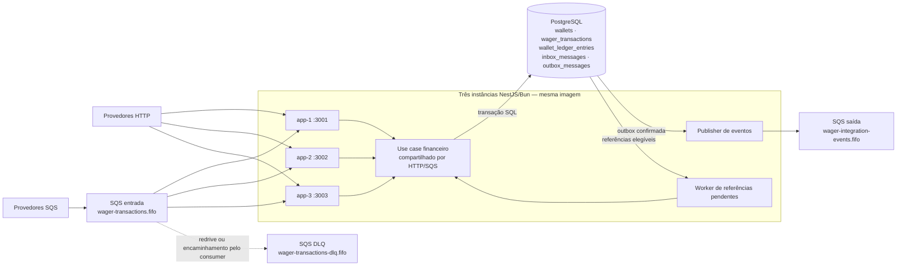

# Distributed Wagering Processor

Serviço financeiro distribuído desenvolvido para o desafio técnico da Jungle Gaming. Processa BET, WIN, LOSS, REFUND e ROLLBACK por HTTP ou SQS, mantendo saldo e ledger consistentes diante de concorrência, duplicatas, referências fora de ordem e falhas de processo.

## Navegação

[Visão geral](#visão-geral-do-projeto) · [Stack e garantias](#stack-tecnológica-e-principais-garantias) · [Arquitetura](#arquitetura-resumida) · [Início rápido](#pré-requisitos-e-início-rápido) · [API HTTP](#api-http) · [Postman](#demonstração-com-postman) · [SQS](#processamento-assíncrono-via-sqs) · [Testes](#testes-e-resultados) · [Observabilidade](#observabilidade) · [Limitações](#decisões-e-limitações) · [Documentação](#documentação-complementar)

## Visão geral do projeto

Três processos da mesma aplicação compartilham PostgreSQL e filas SQS FIFO. Cada operação financeira é identificada persistentemente; repetir uma operação reproduz seu resultado original, incluindo o saldo observado, sem duplicar créditos ou débitos. Alterações de saldo geram lançamentos imutáveis e eventos registrados atomicamente na outbox.

O foco é correção financeira e recuperação distribuída. O ambiente local inclui as três APIs, banco, broker, migrations e workers pelo Docker Compose.

## Stack tecnológica e principais garantias

| Tecnologia | Uso |
| --- | --- |
| Bun 1.x | Runtime, package manager e test runner; imagem validada com Bun 1.4.4 |
| TypeScript strict e NestJS | Aplicação modular, entradas HTTP e composição de dependências |
| decimal.js | Money imutável e aritmética exata; contratos monetários em strings com duas casas |
| PostgreSQL 16.11 e TypeORM | Transações, locks por wallet, constraints, ledger, inbox e outbox |
| AWS SQS / LocalStack 4.14.0 | Entrega at-least-once e filas FIFO de entrada, eventos e DLQ |
| Docker Compose | Infraestrutura local e três instâncias independentes da aplicação |

- Saldo não negativo, sem lost update, com lock individual por wallet e garantias no schema.
- Idempotência persistente compartilhada entre HTTP e SQS; payload divergente com a mesma chave é conflito.
- Wallet, transação, ledger, inbox aplicável e outbox confirmados na mesma transação SQL.
- Ledger protegido contra UPDATE, DELETE e TRUNCATE; reconciliação explícita sem correção silenciosa.
- ACK após commit; publicação após commit, com retry e recuperação por outra instância.

## Arquitetura resumida

Monólito modular com domínio independente de framework, aplicação organizada em casos de uso e infraestrutura nas fronteiras HTTP, SQS e PostgreSQL. HTTP e SQS reutilizam `ProcessWagerTransactionUseCase`; o worker de referências reprocessa pelo mesmo núcleo financeiro.



O diagrama agrupa componentes lógicos: o use case e os workers existem em cada processo, sem um serviço central adicional. O PostgreSQL arbitra concorrência e unicidade; FIFO complementa essas garantias. [Decisões arquiteturais](ARCHITECTURE.md).

## Pré-requisitos e início rápido

Git, Bun 1.x, Docker com containers Linux e Docker Compose v2 com suporte a `up --wait`. Para os exemplos Linux, use Bash e curl. As portas 3001–3003, 5432 e 4566 devem estar disponíveis.

```sh
git clone --branch main https://github.com/andreromani/distributed-wagering-processor.git
cd distributed-wagering-processor
```

Prepare o ambiente em **PowerShell**:

```powershell
Copy-Item .env.example .env
```

Ou em **Linux**:

```sh
cp .env.example .env
```

Não sobrescreva um `.env` existente sem revisar sua configuração. As credenciais de `.env.example` são fictícias e destinadas ao ambiente local. Os comandos seguintes são iguais nos dois ambientes:

```sh
bun install --frozen-lockfile
docker compose config --quiet
docker compose build
docker compose up -d --wait
docker compose ps -a
```

O Compose provisiona as três filas, aguarda PostgreSQL/LocalStack saudáveis, executa migrations e inicia as aplicações da mesma imagem. HTTP, consumer, publisher e referências pendentes ficam habilitados.

| Instância | URL |
| --- | --- |
| app-1 | http://localhost:3001 |
| app-2 | http://localhost:3002 |
| app-3 | http://localhost:3003 |

Confira readiness com `Invoke-RestMethod http://localhost:3001/health/ready` no PowerShell ou `curl -fsS http://localhost:3001/health/ready` no Linux. Repita nas portas 3002 e 3003; a resposta esperada é `{"status":"ok"}`.

### Migrations e execução no host

O Compose aplica migrations automaticamente pelo serviço `migrations`, antes das APIs. Para reaplicar migrations pendentes com a imagem pronta:

```sh
docker compose run --rm migrations
```

No host, com `.env` configurado e banco saudável, os scripts usam o CLI TypeORM com Bun e compilação prévia:

```sh
bun run migration:show
bun run migration:run
```

Para executar uma API no host, use `docker compose up -d postgres localstack`, depois `bun run build` e `bun run start`; a porta padrão é 3000. Os workers ficam desabilitados por padrão fora do Compose. Configuração de flags, geração/reversão de migrations e procedimentos de operação estão no [guia operacional](docs/OPERATIONS.md).

## API HTTP

Valores monetários usam `{ "amount": "100.00", "currency": "BRL" }`. `Idempotency-Key` é obrigatório na submissão de transações; `x-correlation-id` é opcional e retorna na resposta. `x-instance-id` identifica a instância que atendeu a requisição.

| Método | Endpoint | Finalidade |
| --- | --- | --- |
| POST | `/wallets` | Abre wallet; saldo positivo gera OPENING e crédito no ledger |
| GET | `/wallets/:walletId` | Consulta saldo atual e versão |
| GET | `/wallets/:walletId/ledger?limit=2&cursor=...` | Ledger por cursor opaco e específico da wallet |
| POST | `/wallets/:walletId/reconciliation` | Compara saldo materializado com saldo reconstruído pelo ledger |
| POST | `/wagering/transactions` | Processa BET, WIN, LOSS, REFUND ou ROLLBACK |
| GET | `/wagering/transactions/:transactionId` | Consulta pelo ID interno e snapshot original |
| GET | `/providers/:providerId/wagering/transactions/:externalTransactionId` | Consulta pela identidade externa |
| GET | `/health/live` | Liveness do processo; `/health` é um alias |
| GET | `/health/ready` | Readiness de PostgreSQL e SQS |
| GET | `/metrics` | Métricas em formato Prometheus |

Submissões retornam 200 para PROCESSED, 202 para pendência e 422 para rejeição de negócio com `failureCode`. Payload inválido retorna 400; recurso inexistente, 404; conflito, 409; falha transitória, 503. FAILED terminal persistido retorna 500 na submissão/replay e pode ser consultado por GET. Consultas de transações existentes retornam 200 mesmo em estado pendente ou rejeitado. O ledger usa limite padrão 50, máximo 100; suas páginas não compartilham um snapshot imutável.

### Exemplo PowerShell

Cria uma wallet nova, debita 100.00, reproduz a BET pela segunda instância e reconcilia o saldo de 900.00:

```powershell
$api = 'http://localhost:3001'
$playerId = [guid]::NewGuid().ToString()
$walletBody = @{ playerId=$playerId; initialBalance=@{amount='1000.00';currency='BRL'} } | ConvertTo-Json -Depth 4
$wallet = Invoke-RestMethod -Method Post -Uri "$api/wallets" -ContentType 'application/json' -Body $walletBody

$externalId = [guid]::NewGuid().ToString()
$headers = @{ 'Idempotency-Key'="demo:$externalId"; 'x-correlation-id'=[guid]::NewGuid().ToString() }
$betBody = @{
  providerId='demo'; externalTransactionId=$externalId; playerId=$playerId; walletId=$wallet.id
  roundId='demo-round'; gameId='demo-game'; kind='BET'; money=@{amount='100.00';currency='BRL'}
} | ConvertTo-Json -Depth 4

Invoke-RestMethod -Method Post -Uri "$api/wagering/transactions" -Headers $headers -ContentType 'application/json' -Body $betBody
Invoke-RestMethod -Method Post -Uri 'http://localhost:3002/wagering/transactions' -Headers $headers -ContentType 'application/json' -Body $betBody
Invoke-RestMethod -Method Post -Uri "$api/wallets/$($wallet.id)/reconciliation"
```

### Exemplo Linux

O mesmo fluxo, usando Bun para gerar UUIDs e ler JSON, sem depender de jq:

```bash
api='http://localhost:3001'
player_id=$(bun -e 'console.log(crypto.randomUUID())')
wallet=$(curl -fsS -X POST "$api/wallets" -H 'Content-Type: application/json' \
  -d "{\"playerId\":\"$player_id\",\"initialBalance\":{\"amount\":\"1000.00\",\"currency\":\"BRL\"}}")
wallet_id=$(printf '%s' "$wallet" | bun -e 'console.log(JSON.parse(await Bun.stdin.text()).id)')
external_id=$(bun -e 'console.log(crypto.randomUUID())')
bet=$(printf '{"providerId":"demo","externalTransactionId":"%s","playerId":"%s","walletId":"%s","roundId":"demo-round","gameId":"demo-game","kind":"BET","money":{"amount":"100.00","currency":"BRL"}}' \
  "$external_id" "$player_id" "$wallet_id")

curl -fsS "$api/wagering/transactions" -H 'Content-Type: application/json' \
  -H "Idempotency-Key: demo:$external_id" -d "$bet"
curl -fsS 'http://localhost:3002/wagering/transactions' -H 'Content-Type: application/json' \
  -H "Idempotency-Key: demo:$external_id" -d "$bet"
curl -fsS -X POST "$api/wallets/$wallet_id/reconciliation"
```

A abertura retorna 201 e versão 1. A BET retorna PROCESSED, saldo `"900.00"` e `idempotentReplay: false`; o replay mantém transactionId e saldo, com `idempotentReplay: true`. A reconciliação retorna `consistent: true`, saldos armazenado/calculado `"900.00"`, diferença `"0.00"` e dois lançamentos conferidos (OPENING e BET).

## Demonstração com Postman

Importe a [collection v2.1](postman/distributed-wagering.postman_collection.json) e o [environment local](postman/local.postman_environment.json). Selecione **Distributed Wagering — Local** e mantenha as três aplicações prontas. A collection tem 49 requisições e gera identidades novas ao iniciar cada fluxo.

| Pasta | Demonstração |
| --- | --- |
| 01 | Health das três instâncias e métricas |
| 02 | Abertura, consulta, ledger e conflito de wallet duplicada |
| 03 | BET, replay, WIN, LOSS, REFUND, ROLLBACK e reconciliação |
| 04 | Idempotência, rejeições e payloads inválidos em wallet independente |
| 05 | REFUND antes da BET, resolução por worker e reconciliação |
| 06 | Paginação do ledger em páginas de 2, 2 e 1 registros |

Execute em ordem: 03 depende de 02; 06 depende do fluxo 03 completo, sem operações extras na wallet principal. As pastas 04 e 05 criam suas próprias wallets. Sempre reinicie um fluxo pela primeira requisição. Ao executar pastas separadas no Runner, habilite **Keep variable values**; não compartilhe o mesmo environment entre execuções concorrentes.

Na pasta 05, envie REFUND, consulta pendente e BET rapidamente em sequência. Depois aguarde o backoff e repita a consulta até PROCESSED. No Runner, use uma iteração e delay de 1000 ms: o polling é limitado a 20 respostas. Com Send individual, a repetição é manual. Se a referência esgotar tentativas, reinicie a pasta com novas identidades. [Política de referências](#decisões-e-limitações).

## Processamento assíncrono via SQS

A entrada `wager-transactions.fifo` recebe `WagerTransactionRequested`. O consumer valida o envelope, usa o mesmo núcleo financeiro HTTP e deduplica mensagens por inbox persistente. Rejeições de negócio recebem ACK após commit; falhas transitórias recebem retry/backoff e erros permanentes seguem para `wager-transactions-dlq.fifo`.

Eventos são gravados na outbox junto com a operação financeira e publicados após commit em `wager-integration-events.fifo`. A publicação é at-least-once: consumidores precisam deduplicar por eventId. Não há garantia de ordenação global dos eventos.

Com Bun e `.env` local configurados, os comandos são iguais em PowerShell e Linux:

```sh
bun scripts/sqs.ts send message.json
bun scripts/sqs.ts queues
bun scripts/sqs.ts dlq
bun scripts/sqs.ts events
```

`send` valida o arquivo e envia sem esperar o resultado financeiro. `queues` consulta atributos das três filas. `dlq` e `events` recebem amostras de até dez mensagens, com visibilidade zero e sem exclusão; a inspeção pode incrementar o contador de recebimentos. Um envelope inválido é recusado pelo script antes de chegar à fila.

O [guia SQS](docs/OPERATIONS.md#envio-e-inspeção-sqs) contém envelope BET reproduzível, substituição pelos IDs de uma wallet existente, consulta do resultado e envio inválido pelo awslocal para demonstrar DLQ. `message.json` é um artefato local ignorado pelo Git; preserve arquivos existentes ao preparar exemplos.

## Testes e resultados

Unitários usam `bun:test`. Integrações usam PostgreSQL e LocalStack reais em containers, com bancos/filas exclusivos; exigem `.env` configurado e permissão CREATEDB. Após o início rápido, execute os comandos abaixo em qualquer um dos shells. Pare somente as aplicações para reduzir disputa por recursos:

```sh
docker compose stop app-1 app-2 app-3
bun run build
bun run typecheck
bun run lint
bun run test:unit
bun run test:integration
docker compose start app-1 app-2 app-3
```

Como alternativa aos dois comandos de testes, `bun test` executa a suíte convencional completa, incluindo integração, e falha explicitamente se a infraestrutura estiver indisponível. Para a suíte distribuída, aguarde as três aplicações prontas e execute separadamente:

```sh
docker compose up -d --wait
bun run test:distributed
```

A suíte distribuída cria banco e filas exclusivos, testa três processos, concorrência, SIGKILL, publishers, referências e restart, e restaura as aplicações no finally. Não execute outras ferramentas que recriem as aplicações simultaneamente. Dados e evidências são mantidos para auditoria; consulte a [limpeza segura](docs/OPERATIONS.md#limpeza-segura).

### Resultados registrados

| Validação | Resultado registrado |
| --- | --- |
| Suíte convencional final | 517 testes aprovados, zero falhas, 2.102 assertions em 19 arquivos; 134,54 segundos |
| Verificações estáticas e build | Build, typecheck e lint aprovados |
| Suíte distribuída após a correção Windows/Docker | Nove cenários PASS, zero FAIL, 1.208 assertions |
| Demonstração manual | Fluxo principal 1000.00 → 1000.00; replay entre instâncias; ledger 2/2/1; referências; SQS e DLQ |

Execução distribuída final: `11b97e9e-b8b9-4846-ac6f-611c4044927a`, com três instâncias reais simultâneas e `normalConfigurationRestored=true`. Os resultados correspondem à validação final do projeto; o histórico está separado em [evidências, cenários e incidentes](docs/VALIDATION.md).

## Observabilidade

- Logs JSON incluem instanceId, correlação e identificadores aplicáveis, sem corpo financeiro completo, credenciais, SQL ou stack bruto.
- `/health/live` verifica o processo; `/health/ready` verifica PostgreSQL e SQS. Ambos permanecem abertos.
- `/metrics` expõe Prometheus: status de transações, replays, retries, DLQ, conflitos de lock, reconciliação, latência e idade do evento pendente mais antigo da outbox.

PowerShell: `(Invoke-WebRequest -Uri 'http://localhost:3001/metrics' -UseBasicParsing).Content`. Linux: `curl -fsS http://localhost:3001/metrics`. Consulte também as portas 3002 e 3003.

Contadores e histogramas são locais por instância e reiniciam com o processo; representam observações/tentativas conforme seus labels. Gauges `scope=shared` observam o mesmo banco/broker: não os some indiscriminadamente entre instâncias. Quantidades de mensagens SQS são aproximadas. Flags de coleta indicam indisponibilidade; valores anteriores podem ser preservados durante falhas.

## Decisões e limitações

- **Autenticação não implementada.** FinancialAuthGuard é no-op e não oferece segurança. O ponto de extensão prevê IdP OIDC externo e autorização por provider/wallet; não há usuários, senhas ou tokens locais.
- TypeORM foi escolhido por familiaridade e timebox. O domínio permanece independente do ORM; valores monetários são persistidos como NUMERIC(30,2) e strings nos mappers.
- Referências pendentes têm cinco tentativas totais, incluindo a inicial, backoff exponencial de 1s até 60s e TTL de 24h. O limite pode ser atingido antes do TTL. Esgotamento gera REJECTED/REFERENCE_NOT_FOUND; uma BET posterior não reabre o REFUND rejeitado.
- A entrega e publicação são at-least-once, sem ordem causal global. A deduplicação FIFO não substitui idempotência persistente.
- PostgreSQL preserva dados no volume local. Recriar o LocalStack pode perder filas/mensagens; reiniciar somente as aplicações preserva banco e broker existentes.
- O ambiente local usa privilégios administrativos; produção exige separar o papel de migrations do papel da aplicação.
- A causa dos timeouts históricos intermitentes de SQS/readiness permanece inconclusiva. Execuções posteriores aprovadas não comprovam resolução causal. Não há benchmark de carga ou garantia de throughput.

## Documentação complementar

| Documento | Conteúdo |
| --- | --- |
| [ARCHITECTURE.md](ARCHITECTURE.md) | Invariantes, transações, hash canônico, decisões, trade-offs e histórico técnico |
| [Guia operacional](docs/OPERATIONS.md) | Flags, migrations, SQS, shutdown, diagnóstico e limpeza segura de recursos exclusivos |
| [Evidências de validação](docs/VALIDATION.md) | Resultados automatizados/manuais, incidentes e limites das evidências |
| [CHALLENGE.md](CHALLENGE.md) | Requisitos originais do desafio |
| [.env.example](.env.example) | Configuração local de referência |
